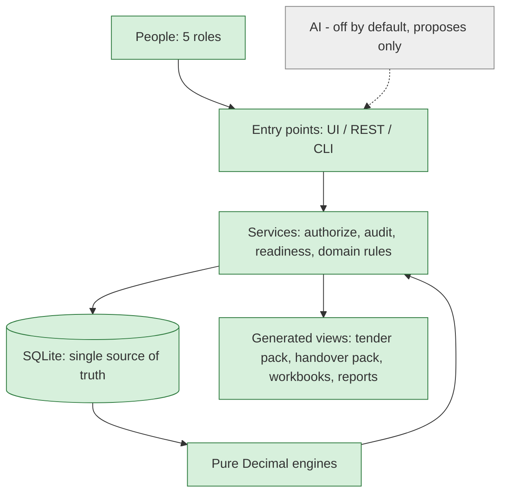

# System map — what is built, what is missing

Legend: **✅ built and exercised by a test or a run** · **🟡 partly built / needs a person's data** · **⬜ not built**.
"Exercised" means a test, the 27-stage synthetic scenario or the real-document practice test ran it — see [PROJECT_HISTORY_AND_NEXT_STEPS.md](PROJECT_HISTORY_AND_NEXT_STEPS.md) for the evidence and [KNOWN_LIMITATIONS.md](KNOWN_LIMITATIONS.md) for the caveats. Mermaid blocks render on GitHub; the ASCII versions read anywhere.

## 1. The whole system on one page

```
                 PEOPLE                                            AI (optional, OFF by default)
  Estimator · Procurement · Commercial Approver · Admin · Viewer    proposes only — no authority
         │                                                                │
         ▼                                                                ▼
 ┌───────────────────────── ENTRY POINTS (one action registry) ─────────────────────────┐
 │  ✅ Web UI: sidebar menu, 16 estimating tabs + 7 tender tabs, help viewer             │
 │  ✅ REST API     ✅ CLI (`app.cli action NAME 'JSON'`)                                │
 │  ✅ UI forms create norms, workforce profiles and activities; review/approve in UI    │
 └───────────────────────────────────────────┬───────────────────────────────────────────┘
                                             ▼
 ┌──────────────────────────────── SERVICES (rules live here) ───────────────────────────┐
 │ ✅ approvals.authorize (role + four-eyes)   ✅ audit (hash-chained)   ✅ readiness gate │
 │ ✅ boq · rates · assumptions · assemblies · procurement · reconciliation · offers       │
 │ ✅ workforce (norms, profiles, activities, baselines) · tender (queries, registers)     │
 └───────────────┬──────────────────────────────────────────────┬──────────────────────────┘
                 ▼                                              ▼
   ┌──────────────────────────────┐              ┌────────────────────────────────────┐
   │ ✅ SQLite = single source of  │◄── reads ───│ ✅ PURE Decimal ENGINES             │
   │ truth (16 migrations,         │   (context)  │ direct cost · indirects · commercial │
   │ immutability triggers)        │              │ productivity · CPM · tax · schedule  │
   └──────────────┬───────────────┘              └────────────────────────────────────┘
                  ▼
   GENERATED VIEWS — ✅ DOCX/XLSX/PDF tender pack (45 docs) · ✅ handover pack (17, hypothetical)
                     ✅ 27-sheet workbook · ✅ reports · ✅ manifests + validator
```



## 2. The tender workflow, stage by stage

```
 A ENQUIRY        ✅ register, bid/no-bid record ───────────────► 🟡 no dedicated UI form
 B DOCUMENTS      ✅ register + revisions + missing docs; text index (flags incomplete PDF text)
                  ⬜ reads drawings/PDF images  — by design: NO OCR, NO drawing measurement
 C BOQ            ✅ CSV/XLSX import, unit canonicalisation, duplicates, change requests
                  ✅ PDF content → person/tool transcribes → import with provenance → 2nd-person check
 D MAPPING+RATES  ✅ manual mapping, versioned approved rates, synthetic-rate labelling
                  🟡 library ships EMPTY: 0 real approved rates, 0 real assemblies for a project
 E QUERIES / RFI  ✅ DRAFT-only detectors: wording (all columns), duplicates, near-duplicate sizes,
                     units, revisions, missing docs, missing rates, assumptions, long-lead, norms
                  ⬜ detectors for "printed formula / printed total vs lines" (needs free-text parsing)
 F METHOD+PROGRAMME ✅ productivity engine, 5 durations, crew scenarios, calendars, baselines
                  🟡 every norm / calendar / workforce profile must be entered + approved by people
 G QUALITY·HSE·COMPLIANCE ✅ registers + skeleton rows ("TO BE COMPLETED BY A COMPETENT PERSON")
                  ⬜ real ITP / HSE / compliance content; ⬜ SBC & procurement-law text not read
 H PROCUREMENT    ✅ needs → RFQ → quotes → levelling → selection → rate publication
                  🟡 no real suppliers or quotations in the system
 I COST·RISK·COMMERCIAL ✅ indirects, risk, escalation, cash flow, tax on schedule, offer letter
                  🟡 payment terms, policy, tax approvals must be real human approvals
 J TENDER PACK    ✅ 45 documents, applicability matrix, validator, blocked-document logic
 K HANDOVER       ✅ 17 documents — HYPOTHETICAL only (needs an explicit award scenario)
 GATES            ✅ four-eyes default · actor types · production readiness · immutability
                  ⬜ MFA / SSO · ⬜ off-box audit anchor · ⬜ encryption at rest
```


```mermaid
flowchart LR
  A[A Enquiry] --> B[B Documents] --> C[C BOQ import] --> D[D Mapping + rates]
  D --> E[E Queries / RFI drafts] --> F[F Method + programme]
  F --> G[G Quality / HSE / compliance] --> H[H Procurement]
  H --> I[I Cost, risk, commercial] --> J[J Tender pack + gates] --> K[K Handover - hypothetical]
  classDef ok fill:#d7f0dc,stroke:#2d7a3e
  classDef part fill:#fff3cd,stroke:#b58900
  class A,B,C,E,J,K ok
  class D,F,G,H,I part
```

Green = built and exercised. Amber = the software exists, but it produces real output only when people supply real data (rates, norms, calendars, quotes, approvals).

## 3. Approval and safety layers (all built)

```
 any write ─► authorize(role, entity, action) ─► four-eyes: author ≠ approver (Admin not exempt)
          ─► approvals row + hash-chained audit row ─► approved record immutable (service + DB trigger)
          ─► readiness: registered HUMAN approvers + production environment + no demo/synthetic
             + region/currency confirmed + transcription checked + no BLOCKED documents
             + no unapproved assumption in use (Critical, never waivable); adopted-unused ones need
               a Commercial Approver's recorded exception
          ─►  PRODUCTION      │  DEMONSTRATION (demo/synthetic/test)  │  NOT READY
```
AI can never write a register row, approve, or publish (tested). A missing rate stays `None`. Unknown is shown as `None`, not `0`.

## 4. What is missing, in one table

| Area | Missing | Who/what closes it |
|---|---|---|
| Real data | approved KSA rates, productivity norms, work calendars, workforce profiles, payment terms, supplier quotes | people, through the existing approve workflows |
| Registered users | real `human` approvers in a production environment | administrator |
| Standards | SBC, Saudi procurement law and 4 productivity-reference families **not read** (register marks them "requires human acquisition") | a person obtains and imports them |
| Content | quality / ITP / HSE / compliance content (only skeletons) | competent persons |
| Security | MFA/SSO, off-box audit anchor, encryption at rest, separated admin duties, pen-test | engineering backlog (SECURITY.md) |
| Product | a document-approval button on the pack page; UI forms for governed parameters (calendar, payment terms); formula/total-vs-lines detectors; cash flow not in the frozen snapshot; open defect O-1 (a human can approve a document built on an Incomplete estimate; it stays Draft) | code backlog (see next-steps doc) |
| By design, never | OCR / PDF-drawing reading, automatic takeoff, AI approvals, invented prices | — |
